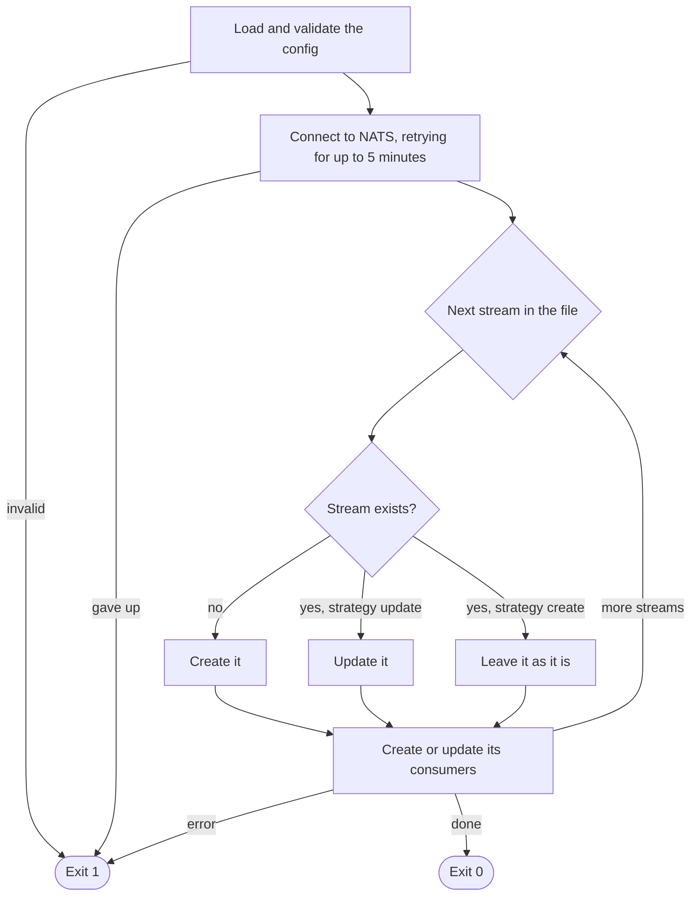

# How it works

The [getting started guide](getting-started.md) showed *what* the provisioner does. This page
explains *how* a run works, so its behavior holds no surprises when you rely on it in production.

Log lines on this page are trimmed: real lines also carry `time`. They were captured against
nats-server v2.12.15.

## A run, from start to finish

A run is one pass from the config file to NATS and back to an exit code. This is the whole of it:



1. **Load the config.** The YAML file is parsed, `${VAR}` references are replaced, and the whole
   config is validated: names, enum values, durations, numeric ranges, duplicates. Every error
   names its path (e.g. `streams[0].max_age`). **NATS hasn't been contacted yet**, so a broken
   config never leaves a half-provisioned server. See [Validation](configuration.md#validation).
2. **Connect** to NATS, retrying with backoff while the server isn't reachable. See
   [Connection retry](#connection-retry).
3. **Provision** each stream and its consumers, in the order of the file (below).
4. **Exit** with code `0` on success, or `1` at the first error. Errors are logged as
   `Failed to load configuration`, `Failed to connect to NATS` or `Provisioning failed`.

There is no dry-run mode and no check after provisioning: what NATS accepted is what you get.

## The provisioning order

Streams are provisioned in the order they appear in the file. Each stream is handled completely,
first the stream itself and then its consumers in file order, before the next stream starts.
The stream comes first because a consumer can only exist inside a stream.

The run **stops at the first error**. Here the second run changed `deliver_policy` of an existing
consumer, which NATS refuses; the consumer after it in the file, `order-audit`, was never touched:

```json
{"level":"INFO","msg":"Ensuring consumer","stream":"ORDERS","consumer":"order-processor"}
{"level":"ERROR","msg":"Provisioning failed","error":"provisioning consumer \"order-processor\" on stream \"ORDERS\": nats: API error: code=500 err_code=10012 description=deliver policy can not be updated"}
```

Nothing that already succeeded is rolled back. That is safe, because every step is idempotent:
fix the cause and run again, and the run picks up where it makes a difference.

## Nothing is deleted

The provisioner reconciles what's **in** the config and ignores everything else:

| You remove from the config… | What happens on the server |
|---|---|
| a stream | Nothing. The stream and its messages stay. |
| a consumer | Nothing. The consumer and its position stay. |
| a stream field (e.g. `discard: new`) | The server keeps its current value. See [How streams are updated](#how-streams-are-updated). |
| a consumer field (e.g. `max_deliver: 5`) | The field goes back to its default. See [How consumers are updated](#how-consumers-are-updated). |

This is deliberate. A typo or a forgotten line must never wipe a stream full of messages.
Deleting a stream or consumer is something you do yourself, for example with
`nats stream rm <stream-name>`.

The flip side: the config describes a **minimum**, not the exact state. Streams and consumers
created by hand or by applications are left alone.

## How streams are updated

When a stream already exists and its strategy is `update` (the default), the provisioner starts
from the stream's **current configuration on the server** and overlays only the fields you set in
the YAML. A field you leave out keeps whatever value the server has, so removing `discard: new`
from the file doesn't switch the stream back to `discard: old`:

```yaml
# first run                         # second run
streams:                            streams:
  - name: EVENTS                      - name: EVENTS
    subjects: ["events.>"]              subjects: ["events.>"]
    discard: new
    max_msgs: 1000
```

```console
$ nats stream info EVENTS | grep -E 'Discard|Maximum Messages'
               Discard Policy: New
             Maximum Messages: 1,000
```

Three details follow from this:

- **`subjects` is always replaced** with the list in the YAML. It's a required field, so the
  config always says what it should be.
- **A limit is removed by setting it**, not by deleting the line: for example `max_msgs: -1`.
  [Limit how much a stream keeps](howto/limit-stream-size-and-age.md) shows how for each limit.
- **`description` can be changed but not cleared**: an empty description counts as "not set".

The update is sent on every run, even when nothing changed; NATS treats an identical update as a
no-op. The log says `Updating stream` either way.

## Fields that can't change after creation

Four stream fields are never changed on an existing stream: `storage`, `retention`,
`deny_delete` and `deny_purge`. NATS fixes `storage` and `retention` when the stream is created.
For `deny_delete` and `deny_purge`, NATS refuses to turn them off once they're on (error code
10052); turning them on later is allowed by the server, but the provisioner doesn't do that
either. See [Protect a stream's messages from deletion and purge](howto/protect-messages-from-deletion.md).

So on an update the server's value always wins. If your YAML **explicitly** sets one of these
fields to a different value, the provisioner logs a warning, updates everything else, and the
run still succeeds. Here `ORDERS` was created with file storage, and the YAML now says
`storage: memory`:

```json
{"level":"WARN","msg":"Stream storage type mismatch (immutable, cannot be changed)","stream":"ORDERS","current":"file","desired":"memory"}
{"level":"INFO","msg":"Updating stream","stream":"ORDERS"}
{"level":"INFO","msg":"Provisioning complete"}
```

The other three warnings are `Stream retention policy mismatch (immutable, cannot be changed)`,
`Stream deny_delete mismatch (immutable, cannot be changed)` and
`Stream deny_purge mismatch (immutable, cannot be changed)`. If you leave the field out of the
YAML, there's no warning: nothing was asked for, so nothing differs.

Watch for these warnings after you edit one of the four fields: the exit code doesn't tell you
the change wasn't applied. Changing one of them really means deleting and recreating the stream,
which deletes its messages, and that is outside what the provisioner does.

## How consumers are updated

Consumers work differently from streams. Every run sends the **full** consumer configuration
from the YAML to NATS in one create-or-update call, with no merge with the server's state. A
field you remove from the YAML goes back to its default: remove `max_deliver: 5`, re-run, and
the consumer's `max_deliver` is `-1` (unlimited) again; remove `max_ack_pending` and it is back
at the server default of 1000.

The consumer's **position** is not part of its configuration, so an update keeps it: messages
already acknowledged aren't delivered again.

NATS refuses some changes to an existing consumer: `deliver_policy`, `opt_start_seq`,
`opt_start_time` and `replay_policy` can't be changed (errors `deliver policy can not be updated`,
`start sequence can not be updated`, `start time can not be updated`,
`replay policy can not be updated`, all `err_code=10012`). The run then fails with exit code `1`,
as shown under [The provisioning order](#the-provisioning-order). Changes to fields such as
`filter_subject`, `max_ack_pending`, `description` and `inactive_threshold` are accepted. To apply such a change, delete the consumer
(`nats consumer rm <stream-name> <consumer-name>`) and run the provisioner again; the recreated
consumer starts from its `deliver_policy`, not from the old position.

Only pull consumers are supported: `deliver_subject` and `deliver_group` pass validation but
always fail when the consumer is provisioned. See [Consumers](configuration.md#consumers).

## Durable consumers and inactivity

From release 1.1.1 on, every consumer the provisioner creates is **durable**: it has a durable
name equal to its `name`, and NATS keeps it, with its position, whether or not an application is
connected. That's what you want for a consumer provisioned ahead of the applications that use it.

`inactive_threshold` overrides that. If you set it, NATS deletes even a durable consumer once no
application has used it for that long (not while a delivered message is still waiting for its
acknowledgment). Until the next provisioner run recreates it, applications that fetch from it
fail, because the consumer doesn't exist. The recreated consumer starts again from its
`deliver_policy`: on a stream with the default `retention: limits` it delivers messages that were
already acknowledged once more. (On a `workqueue` stream acknowledged messages are already
removed, so only delivery counts start over.) Here a consumer with `inactive_threshold: 10s` on a
limits stream had acknowledged two messages, sat idle for 12 seconds, and was provisioned again:

```console
$ nats consumer ls UPGRADE
No Consumers defined
$ nats consumer info UPGRADE worker | grep -E 'Acknowledgment Floor|Unprocessed'
    Acknowledgment Floor: Consumer sequence: 0 Stream sequence: 0
    Unprocessed Messages: 2
```

Leave `inactive_threshold` out unless you want idle consumers to disappear.

### Upgrading from 1.1.0

Release 1.1.0 and earlier created consumers **without** a durable name, so NATS treated them as
ephemeral: it deleted them about five seconds after the last application stopped using them (or
after `inactive_threshold`, if set). The next run created them again, from scratch.

After an upgrade to 1.1.1, the first run converts each existing consumer to durable
in place and keeps its position. The server keeps the ephemeral consumer's 5-second inactivity
limit on that conversion, so the provisioner sends the consumer's config a second time in the
same run to remove it. Ten seconds after the upgrade run, with no application connected, the
consumer is still there:

```console
$ nats consumer info <stream-name> <consumer-name> --json | grep -E 'durable_name|inactive_threshold'
    "durable_name": "<consumer-name>",
```

`durable_name` is there and `inactive_threshold` isn't: the consumer is durable and no longer
expires. (If you set `inactive_threshold` in the YAML, it shows that value instead.)

Further reading: [Pull consumers](https://docs.nats.io/learn/jetstream/pull-consumers) in the
NATS documentation.

## Strategy: `update` or `create`

`strategy` decides what happens to a stream that **already exists**:

- **`update`** (default): update it as described under
  [How streams are updated](#how-streams-are-updated).
- **`create`**: leave it exactly as it is. Only a missing stream is created. No mismatch warnings
  are logged, because nothing is compared.

`create` is for streams the provisioner should set up once and then hand over, for example a
stream whose limits an operator tunes by hand with `nats stream edit`.

The strategy can be set globally and overridden per stream:

```yaml
strategy: create          # default for every stream below

streams:
  - name: AUDIT           # created once, then left alone
    subjects: ["audit.>"]
  - name: ORDERS
    strategy: update      # always updated
    subjects: ["orders.>"]
```

**The strategy applies to streams only.** A skipped stream's consumers are still created or
updated on every run. Here `ORDERS` exists and the strategy is `create`:

```json
{"level":"INFO","msg":"Skipping existing stream (strategy=create)","stream":"ORDERS"}
{"level":"INFO","msg":"Ensuring consumer","stream":"ORDERS","consumer":"order-processor"}
{"level":"INFO","msg":"Provisioning complete"}
```

## Connection retry

When the provisioner starts before NATS is ready, which is normal in Docker Compose and
Kubernetes, it retries the connection instead of failing. The delay starts at 1 second and
doubles after each attempt up to 30 seconds (1s, 2s, 4s, 8s, 16s, 30s, 30s, …). Retrying stops
when a connection succeeds or after **5 minutes** in total; the limit of 16 attempts in the code
is never reached, because the 5 minutes run out at about the 14th attempt.

Every failed attempt logs a warning. `delay` is in nanoseconds (`1000000000` is 1 second):

```json
{"level":"INFO","msg":"Connecting to NATS","url":"nats://localhost:14402"}
{"level":"WARN","msg":"NATS not ready, retrying","attempt":1,"max_attempts":16,"delay":1000000000,"error":"nats: no servers available for connection"}
{"level":"WARN","msg":"NATS not ready, retrying","attempt":2,"max_attempts":16,"delay":2000000000,"error":"nats: no servers available for connection"}
{"level":"WARN","msg":"NATS not ready, retrying","attempt":3,"max_attempts":16,"delay":4000000000,"error":"nats: no servers available for connection"}
```

When the 5 minutes are up, the run ends with
`{"level":"ERROR","msg":"Failed to connect to NATS","error":"connection timeout after 5m0s: context deadline exceeded"}`
and exit code `1`. Stopping the provisioner while it retries (SIGINT or SIGTERM) ends it with
`connection canceled: context canceled` instead.

**Every** connection error is retried, including a wrong password or token. A run with bad
credentials therefore fails only after 5 minutes, with warnings that carry the server's error
(`nats: Authorization Violation`). If a run hangs at `Connecting to NATS`, read the `error`
field of the warnings before you wait it out.

## Logs and credentials

Logs are JSON lines on standard output, one per action. `LOG_LEVEL` accepts `debug`, `info`
(default), `warn` and `error`, in lowercase; any other value means `info`. `warn` leaves only warnings and errors. See
[Environment variables](deployment.md#environment-variables).

What the provisioner does to keep credentials out of the logs depends on the release:

- **`NATS_USER` / `NATS_PASSWORD` and `NATS_TOKEN`** are never written to the log by the
  provisioner itself. From release 1.1.1 on, a password that shows up in a connection error is
  replaced by `redacted` as well. Error redaction doesn't cover the token.
- **Credentials in `NATS_URL`** (`nats://<user>:<password>@<host>:4222`) are written **in plain
  text** by release 1.1.0, on the `Connecting to NATS` and `Connected to NATS` lines and possibly
  in retry warnings. From release 1.1.1 on, they are replaced by `redacted`:

  ```json
  {"level":"INFO","msg":"Connecting to NATS","url":"nats://redacted@localhost:14402"}
  ```

If you still run 1.1.0, pass credentials in `NATS_USER` / `NATS_PASSWORD` or
`NATS_TOKEN`, not in `NATS_URL`. [Authenticate to a secured NATS server](howto/authenticate-to-nats.md)
shows each option.

Validation errors quote the value that failed (`invalid duration "14days"`), including values that
came from `${VAR}` expansion. The config has no secret fields, so this only matters if you expand
a secret into one by mistake.

## Next steps

- [Configuration reference](configuration.md) lists every field.
- [Deployment](deployment.md) covers images, Kubernetes, the standalone binary and exit codes.
- [FAQ](faq.md) answers the questions that come up once it runs in production.
